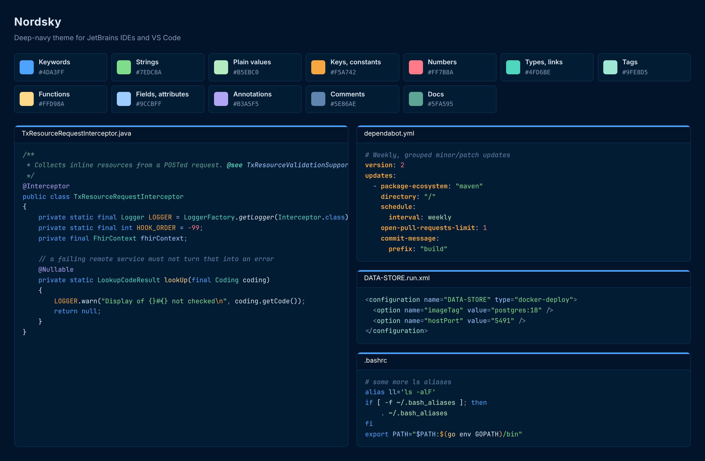

# Nordsky

Dunkles Theme in tiefem Marineblau für JetBrains-IDEs (IntelliJ IDEA, WebStorm, PyCharm, …)
und VS Code. Blaue Schlüsselwörter, grüne Strings, orange Keys und Konstanten, türkise Typen,
korallrote Zahlen.



| Rolle | Farbe | | Rolle | Farbe |
|---|---|---|---|---|
| Editor-Hintergrund | `#011C33` | | Typen, Links | `#4FD6BE` |
| Text | `#DCE7F2` | | Tags (XML/HTML) | `#9FE8D5` |
| Schlüsselwörter | `#4DA3FF` | | Funktionsdeklarationen | `#FFD98A` |
| Strings | `#7EDC8A` | | Felder, Attribute | `#9CCBFF` |
| Unquotierte Werte (YAML) | `#B5EBC0` | | Annotationen | `#B3A5F5` |
| Keys, Konstanten, Escapes | `#F5A742` | | Kommentare | `#5E86AE` |
| Zahlen | `#FF7B8A` | | Doc-Kommentare | `#5FA595` |

Alle Textfarben erreichen auf dem Editor-Hintergrund mindestens WCAG-AA-Kontrast (4.5:1);
der Generator bricht ab, wenn eine Farbe darunter fällt.

## JetBrains-IDEs

Gebaut wird mit dem offiziellen [IntelliJ Platform Gradle Plugin](https://plugins.jetbrains.com/docs/intellij/tools-intellij-platform-gradle-plugin.html)
(benötigt JDK 21, Gradle kommt über den Wrapper):

```bash
cd jetbrains
```

```bash
./gradlew buildPlugin
```

Das Ergebnis liegt in `jetbrains/build/distributions/nordsky-theme-<version>.zip`.
Installation: *Settings → Plugins → ⚙ → Install Plugin from Disk…*, danach unter
*Settings → Appearance & Behavior → Appearance → Theme* **Nordsky** wählen. Das Plugin bringt
UI-Theme und Editor-Farbschema mit; unterstützt werden IDEs ab 2023.1.

Weitere Tasks:

| Task | Zweck |
|---|---|
| `./gradlew runIde` | startet eine Sandbox-IDE mit dem Theme |
| `./gradlew verifyPlugin` | JetBrains Plugin Verifier gegen 2023.1 und 2024.3 |
| `./gradlew publishPlugin` | Veröffentlichung im Marketplace (Token nötig) |

## VS Code

Gebaut wird mit dem offiziellen Tool [`@vscode/vsce`](https://github.com/microsoft/vscode-vsce):

```bash
cd vscode
```

```bash
npm install
```

```bash
npm run package
```

Installation der erzeugten `nordsky-theme-<version>.vsix`: *Extensions → … → Install from VSIX…*,
danach *Preferences: Color Theme → Nordsky*.

## Farben anpassen

Sämtliche Theme-Dateien werden aus einer einzigen Palette erzeugt. Farben in
`scripts/generate.py` (Dictionary `P`) ändern, dann:

```bash
python3 scripts/generate.py
```

Das schreibt das JetBrains-Farbschema, das UI-Theme, das VS-Code-Theme und `docs/preview.html`
neu. Anschliessend die Pakete wie oben bauen.

```
scripts/generate.py                      Palette und Generator
jetbrains/                               Gradle-Projekt des JetBrains-Plugins
  src/main/resources/META-INF/plugin.xml
  src/main/resources/themes/             Nordsky.theme.json, Nordsky.xml (generiert)
vscode/                                  VS-Code-Erweiterung
  themes/nordsky-color-theme.json        (generiert)
docs/                                    Vorschau
```
